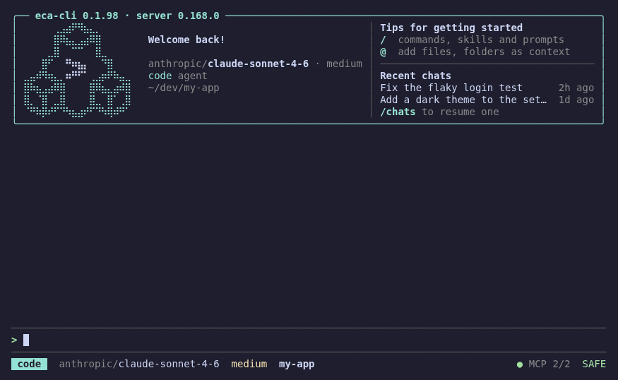

# ECA CLI

[](https://github.com/editor-code-assistant/eca-cli/releases)
[](./LICENSE)



ECA (Editor Code Assistant) CLI is an AI-powered pair-programming client for your terminal, no editor required.
It connects to an external `eca` server process to provide interactive chat, tool calls with live diffs, context management and more, all keyboard-driven.

For more details about ECA, features and configuration, check [ECA server](https://github.com/editor-code-assistant/eca).

This CLI will auto download `eca` and manage the process.

## Requirements

- Linux or macOS, on x86_64 or arm64

## Installation

```bash
bash <(curl -fsSL https://raw.githubusercontent.com/editor-code-assistant/eca-cli/main/install)
```

This installs a single self-contained `eca-cli` binary, no Babashka or JVM needed, in `~/.local/bin` (`/usr/local/bin` as root); pass `--dir <dir>` to pick another place. Run it again to update.

Binaries are also on the [releases page](https://github.com/editor-code-assistant/eca-cli/releases), along with `eca-cli.jar`, which runs on any other platform with [Babashka](https://babashka.org/): `bb eca-cli.jar`.

## Quickstart

```bash
cd your-project
eca-cli
```

By default, ECA starts below your command and grows with the conversation. Completed chat stays in your terminal's native scrollback, even after you exit.

Press `Ctrl+O` to open the full-screen transcript: inspect, expand and scroll through blocks, then press it again to return. Prefer the old full-screen experience? Run `eca-cli --fullscreen`.

## Features

- Opens on a welcome screen: ECA's logo, the versions, your model and agent, tips to get started and your recent chats to resume
- Chat with any model and agent configured in ECA, with streaming responses rendered as markdown: syntax-highlighted code, tables, lists and links
- Approve tool calls inline, with coloured diffs for file edits and a breakdown of shell commands; remember approvals for the chat
- Answer the agent's questions by picking an option or typing your own answer
- Steer the agent while it works, or queue your next message
- Follow the agent's plan in a task panel above the prompt
- The server's commands, skills and prompts from the `/` picker
- A status line showing agent, model, context window use, cost and MCP health at a glance
- Add files, folders, images and MCP resources as context with `@`; point the agent at a file's path with `#`
- Log in and out of providers, and start, stop, connect or disable MCP servers, from panels
- Resume, fork and roll back chats; flag checkpoints and jump between them
- Collapsible tool calls, thinking and sub-agent blocks
- Takes on your terminal's colour theme, dark or light (`NO_COLOR` turns colours off)

## Usage

```
eca-cli [options] [prompt]
```

```bash
eca-cli                                  # chat in the current directory
eca-cli "explain this project"           # start the chat with a prompt
eca-cli -c                               # continue the workspace's latest chat
eca-cli -f src/core.clj "what's wrong?"  # attach files (repeatable)
eca-cli --model anthropic/claude-sonnet-4-6 --agent plan --variant high
```

Run `eca-cli --help` for all the options.

### Scripting

With `-p` (and whenever stdin or stdout isn't a terminal), eca-cli runs the prompt, prints the answer and exits:

```bash
eca-cli -p "what does src/main.clj do?"
git diff | eca-cli -p "review this change"        # piped input is context for the prompt
echo "list the TODOs" | eca-cli                   # ...or the prompt itself
eca-cli -p -c "now add tests for it" --trust       # continue the latest chat
eca-cli -p "summarize the changes" --output-format json --ephemeral
```

| Option | Action |
|---|---|
| `--output-format text\|json\|stream-json` | `text`: the answer. `json`: one result object (`chatId`, `result`, `isError`, `error`, `model`, `usage`, `durationMs`, `rejectedToolCalls`). `stream-json`: an `init` line, the server's chat events as they come (`{"type":"chat/contentReceived","params":…}`, see ECA's protocol), then the result |
| `-o, --output-last-message <file>` | Also write the answer to a file |
| `--ephemeral` | Delete the chat afterwards |
| `--title <title>` | Name the chat (also in the TUI) |
| `--trust` | Approve the tool calls that would ask. Without it, eca-cli rejects them (saying so on stderr): nobody is there to approve |
| `--list-models`, `--list-chats` | List the models, or the workspace's chats; `--json` for JSON |
| `--log-level`, `--verbose`, `--config-file` | Passed to the ECA server: its log level, protocol logging, a config file replacing the global and project ones |

What the agent does goes to stderr when it's a terminal; stdout only gets the answer. Exit codes: `0`, `1` when the turn fails (a provider error, a login needed, the server gone), `2` for bad options, `130` on Ctrl+C. Piped input must start coming within a second (eca-cli won't wait on a stdin left open with nothing to say); for a slow command, save its output first.

### Commands

Type `/` in an empty input to pick one, or type its name and a space to give it arguments (`/rename My chat`, `/compact keep the API notes`). The picker also lists the ECA server's own commands (`/compact`, `/init`, `/context`, `/costs`, `/fork`, `/resume`, …), your skills and prompts.

| Command | Action |
|---|---|
| `/model` | Pick a model (also `Alt+P` / `Ctrl+L`) |
| `/agent` | Pick an agent |
| `/variant` | Pick the model's variant (e.g. reasoning effort) |
| `/rename <title>` | Rename the chat |
| `/new` | Start a fresh chat (also `Ctrl+N`); the current one stays, to resume with `/chats` |
| `/chats` | Browse and resume previous chats |
| `/mcp` | MCP servers: status; start, stop, connect, enable, disable, log out |
| `/providers` | Providers: login state, models, quota; log in or out |
| `/jobs` | Background shell jobs |
| `/trust` | Toggle trust mode (run tool calls without asking) |
| `/rollback` | Roll the chat back to before one of your messages |
| `/flag <text>` | Flag your latest message as a checkpoint |
| `/flags` | Jump to, fork a new chat from, or remove a flag |
| `/timeline` | Jump to one of your messages or a flag |
| `/clear` | Clear the chat display |
| `/login` | Log in to a provider |
| `/help` | Show available commands |
| `/keys` | Show keyboard shortcuts (also `?` on an empty prompt) |
| `/quit` | Exit |

`/new`, `/clear` and resuming a chat each start a new current transcript; previously printed terminal history stays. `/clear` only clears the local display, not the chat on the server. To delete a chat, use the server's `/delete-chat` (it asks you to confirm).

### Keybindings

| Key | Action |
|---|---|
| `Enter` | Send message / toggle the focused block; while the agent works, steer it |
| `Ctrl+J` | New line (also `Shift+Enter` where the terminal tells it from `Enter`, or `\` then `Enter`) |
| `@` / `#` | Add a context / insert a path (at the start of a word) |
| `Alt+Enter` | While the agent works, queue a message for when it's done |
| `↑` on an empty input | While the agent works, take back what you steered or queued |
| `Shift+Tab` | Next agent (e.g. `code` ↔ `plan`) |
| `Alt+T` | Next variant (reasoning effort), none included |
| `Alt+P` / `Ctrl+L` | Pick a model |
| `Ctrl+P` / `F2` | Next recently picked model (`Shift+F2`: previous) |
| `Ctrl+Y` | Toggle trust mode |
| `Ctrl+N` | New chat (like `/new`) |
| `Ctrl+R` | Search the prompt history |
| `Ctrl+G` | Edit the prompt in `$VISUAL` / `$EDITOR` (else `vi`, or `nano`) |
| `?` on an empty input | List the keyboard shortcuts |
| `y` / `n` / `Y` | Approve / reject / approve and remember a tool call for the chat |
| `Esc` | Stop the running prompt, close a picker, clear focus; twice on an empty input: `/rollback` |
| `Ctrl+O` | Toggle the full-screen transcript (when started inline) |
| `Tab` | Focus the next block; `↑` / `↓` move focus once selected, `←` / `→` fold / unfold it |
| `Alt+↑` / `Alt+↓` | Jump between top-level blocks |
| `Alt+g` / `Alt+G` | Focus the first / last block |
| `Alt+c` / `Alt+o` | Collapse / expand blocks (live blocks inline; all in full screen) |
| `Ctrl+T` | Show / hide the agent's task list |
| `↑` / `↓` | Input history (or move focus) |
| `PgUp` | Open the transcript and scroll up; in full screen, scroll up |
| `PgDn` | Scroll down in full screen (no action inline) |
| Mouse wheel | Native terminal scrollback inline; chat scrolling in full screen |
| `Ctrl+C` | Clear the input, or stop the agent; press twice to quit (`Ctrl+D` on an empty input too) |

The model, agent, variant and trust keys work while the agent works too, and apply from the next prompt. On macOS, `Alt` keys need the terminal to send Option as Meta.

An approval never interrupts typing: arriving while you type a message, it waits above the prompt until you pause. Keys typed as it appears, and pasted text, go to your message instead of answering it.

Inline, only live blocks can be focused; use the transcript to inspect completed ones. Selecting or expanding a live block opens the transcript if it would not fit on screen.

The transcript opens on the newest block, focused, and reads like a pager. With a block focused:

| Key | Action |
|---|---|
| `↑` / `↓`, `k` / `j` | Previous / next block (messages included) |
| `Enter` / `Space` | Fold or unfold the block |
| `←` / `→`, `h` / `l` | As in a tree: fold, or go up to the parent; unfold, or go into the first sub-item |
| `e` / `E` | Unfold / fold everything |
| `g` / `G` | First / last block |
| `y` | Copy the block: a message, a thought, a diff, a command and its output |
| `Esc` | Clear focus, to type in the prompt (your draft is kept) |
| `q` / `Ctrl+O` | Return inline |

While a tool call waits for approval or a question for its answer, letters keep answering them (`y` approves); arrows, `Enter` and `Esc` still move around a focused block. Copying uses the terminal (OSC 52, which also works over SSH, and in tmux with `set-clipboard on`) and, when there is one, `pbcopy`, `wl-copy`, `xclip` or `xsel`.

## Troubleshooting

Check [troubleshooting](https://eca.dev/troubleshooting) docs section.

## Development

Requires [Babashka](https://babashka.org/) 1.12.215 or later.

```bash
bb run     # run from source, takes the same options as eca-cli
bb test    # unit tests
bb nrepl   # nREPL on port 7888
bb dist    # build the release binaries into dist/
bb demo    # re-record demo.gif against a scripted server (needs tmux, Chrome and ffmpeg)
```

Every push to `main` is released automatically. See [CLAUDE.md](./CLAUDE.md) for the architecture.

## Contributing 💙

Contributions are very welcome, please open an issue for discussion or a pull request.

## License

Apache License 2.0, see [LICENSE](./LICENSE).
